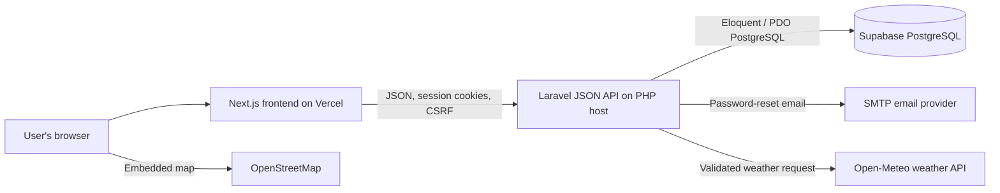

# Waypoint — System Integration Remediation Project

## Project overview

Waypoint is a secure, responsive web application demonstrating how a modern frontend, an independently hosted backend API, a relational database, and external services work together. Its frontend is built with Next.js and React; its REST API is built with PHP Laravel; its persistent data store is PostgreSQL, with Supabase as the recommended managed provider. The application also integrates live weather and mapping services.

The goal is to demonstrate the complete integration lifecycle: account creation, authentication, protected data, database persistence, communication with external APIs, security controls, version control, deployment, and troubleshooting. The application must be understood and tested by the student who presents it. A local-only application does not satisfy the deployment objective.

## Architecture and technology choices

- **Frontend:** Next.js App Router, React, TypeScript, responsive CSS.
- **Backend:** PHP 8.2+ and Laravel 12, serving JSON REST endpoints.
- **Authentication:** Laravel Sanctum stateful session cookies and CSRF protection.
- **Database:** PostgreSQL, configured to connect to Supabase or another approved PostgreSQL service.
- **Maps:** OpenStreetMap embedded map, with optional browser geolocation.
- **Weather:** Open-Meteo current conditions requested through the Laravel API.
- **Frontend hosting:** Vercel, required for the Next.js application.
- **Backend hosting:** A PHP-compatible service or Docker host, separate from the Next.js Vercel deployment.
- **Version control:** Git and a GitHub repository owned by the student.



The browser calls the deployed Laravel API using `NEXT_PUBLIC_API_URL`. The API validates requests, applies authentication and authorization, and performs database access on the server. Database passwords, Laravel's application key, and mail credentials remain private backend environment variables. Weather requests are proxied by Laravel; the map is embedded from OpenStreetMap. Neither external service requires a browser-delivered secret for this implementation.

## Functional requirements and implementation

### Registration and sign-in

The responsive account interface supports registration with name, email, password, and password confirmation, and sign-in with email and password. Laravel validates all input server-side, stores passwords as bcrypt hashes, rotates sessions after authentication, and returns clear JSON validation or credential errors. A successful sign-in opens the protected dashboard. If MFA is enabled, password verification starts a short-lived pending MFA session rather than authenticating the user immediately.

### Protected dashboard

The dashboard displays the signed-in user's profile, live weather, an interactive map view, MFA status and controls, and a sign-out action. User and weather endpoints are protected by Sanctum. If a visitor has no valid session, protected data is not returned. Loading, successful actions, provider errors, and authentication errors have visible UI states.

### Maps and location

The dashboard embeds an OpenStreetMap view centered on a default location. A user may grant browser geolocation permission to center the map and refresh weather for the current coordinates. The application handles denied or unavailable location access without preventing other dashboard features. Map attribution is shown.

### Weather

The Laravel weather endpoint accepts latitude and longitude, validates coordinate ranges, calls the Open-Meteo forecast API, validates the response shape, and returns the current temperature, apparent temperature, humidity, wind speed, weather code, day state, and provider timestamp. The dashboard displays these values and reports loading or unavailable-provider states. Upstream failures are logged server-side and returned as safe error responses.

### Forgot password and reset

The account recovery screen accepts an email address. Laravel issues a time-limited password reset token and sends a reset link through the configured mail provider. The API's response does not reveal whether the address is registered. The reset screen validates the token, email, new password, and confirmation; successful use changes the password and invalidates the token. Requests are rate-limited. Local development can use Laravel's log mailer; a production SMTP provider is required for delivered recovery emails.

### Multi-factor authentication

Users can enroll an authenticator application using a TOTP secret and confirm setup with a current six-digit code. The pending enrollment expires after ten minutes. The secret is encrypted before it is stored in PostgreSQL. At sign-in, a valid TOTP code is required to complete authentication. Verification attempts are rate-limited, and a successfully used time step cannot be reused. MFA secrets are only revealed during setup. Disabling MFA requires verification with a current code.

## Database integration and data lifecycle

Laravel connects to PostgreSQL using the `pgsql` connection and private backend environment settings. The migrations create persistent user records, password-reset tokens, database-backed sessions, cache storage, and queue tables. Eloquent models and parameterized queries handle reads and writes.

The request lifecycle is:

1. The browser sends a JSON request to the Laravel API with the Sanctum session cookie and, for state-changing requests, the CSRF header.
2. Laravel validates the request, checks authentication and authorization, and runs the applicable rate limiter.
3. Eloquent uses the server-side PostgreSQL connection to create or read data.
4. For weather, Laravel calls the external provider and returns only the required response fields to the browser.
5. The frontend renders the result or displays a useful loading or error state.

When Supabase is used, this application connects from Laravel using PostgreSQL/PDO. The browser does not access Supabase directly, so no service-role key is included in client code.

## Security measures and enforcement

- **Password storage:** Laravel's bcrypt hashing and hashed model cast; plaintext passwords are not saved.
- **Server-side input validation:** Laravel controllers validate account, password reset, MFA, and weather requests. Client-side constraints are supplemental only.
- **SQL injection protection:** Eloquent and Laravel's parameterized database operations are used instead of concatenating user input into SQL.
- **Authentication and authorization:** Sanctum stateful sessions protect dashboard API routes; the MFA challenge does not authenticate the user until verified.
- **Session and CSRF protection:** Secure session cookies, CSRF tokens for state-changing requests, and session rotation/invalidation on authentication changes.
- **Password recovery:** Time-limited, single-use token broker; generic request response; rate limiting.
- **MFA:** Encrypted TOTP secrets, expiring enrollment, throttling, and replay protection.
- **CORS:** Exact configured origins with credential support; wildcard credentialed origins are not used.
- **External API errors:** Coordinate validation, bounded provider timeout, server-side warning logs, and safe client-facing messages.
- **Secrets:** Private backend credentials stay in server environment configuration. `NEXT_PUBLIC_` variables are treated as public.
- **Production transport:** HTTPS is required for production and secure session cookies must be enabled.

Production browser-cookie authentication requires compatible frontend/API domains and correct CORS, Sanctum, cookie-domain, SameSite, and Secure settings. Prefer a custom frontend domain and API subdomain under the same site. A Vercel default domain and an unrelated API hostname may be treated as third-party cookies by browsers and can prevent sessions from working.

## GitHub, repository contents, and configuration

The GitHub repository should contain:

- `frontend/`: Next.js source, package manifest, and Vercel configuration.
- `backend/`: Laravel source, REST routes, controllers, models, migrations, tests, Docker deployment files, and Composer manifest.
- `README.md`: setup, architecture, environment variables, endpoints, security, and deployment instructions.
- `PROJECT-DESCRIPTION.md`: this complete project description and implementation overview.
- `.gitignore` and example environment files with placeholders only.

Use meaningful commits to show development progress. Do not commit real passwords, API secrets, database credentials, tokens, Laravel application keys, `node_modules`, or Laravel's generated `vendor` directory. After the first Composer dependency resolution, review and commit `backend/composer.lock` so backend builds are reproducible.

## Vercel frontend deployment

The Next.js frontend is configured as a Vercel project in `frontend/`, with `frontend/vercel.json` identifying the Next.js framework. To deploy:

1. Push the repository to a GitHub account and import it into Vercel.
2. Set the Vercel project's **Root Directory** to `frontend`.
3. Use the Next.js framework preset and the standard `npm run build` command.
4. Add `NEXT_PUBLIC_API_URL` in Vercel's environment settings, set to the deployed Laravel API origin.
5. Deploy and confirm that the public site loads over HTTPS.
6. Configure the Laravel API host with the production frontend origin in `CORS_ALLOWED_ORIGINS` and `SANCTUM_STATEFUL_DOMAINS`.
7. Configure the production cookie domain, HTTPS-only cookies, and SameSite settings for the chosen frontend/API domains.
8. Redeploy after relevant environment changes and test the production frontend against the production API.

The Vercel project configuration does not itself create a deployment or provide an account, domains, API URL, or credentials. Those require the student's GitHub/Vercel accounts and backend host configuration.

## Laravel API deployment

Deploy Laravel separately on a PHP-compatible service or Docker host using `backend/Dockerfile`. Configure its private environment variables in that hosting provider:

- `APP_KEY`, `APP_URL`, `FRONTEND_URL`, `APP_ENV=production`, and `APP_DEBUG=false`.
- PostgreSQL/Supabase host, port, database, username, password, and SSL requirements.
- Exact production CORS and Sanctum origins/domains.
- Secure session settings for the HTTPS domain arrangement.
- SMTP server credentials and approved sender address.

Run reviewed migrations against the production database and inspect host logs and the Laravel `/up` health endpoint. The included Docker entrypoint currently runs migrations at container startup; production teams may instead run migrations as a controlled release step.

## Environment variable summary

### Frontend (public)

| Variable | Example | Description |
|---|---|---|
| `NEXT_PUBLIC_API_URL` | `https://api.example.com` | Public origin of the deployed Laravel API. |

### Backend (private)

| Variable | Description |
|---|---|
| `APP_KEY` | Laravel encryption key; generate with `php artisan key:generate`. |
| `APP_URL` | Public Laravel API URL. |
| `FRONTEND_URL` | Frontend URL where password-reset links should open. |
| `DB_CONNECTION` | PostgreSQL connection driver (`pgsql`). |
| `DB_HOST`, `DB_PORT`, `DB_DATABASE`, `DB_USERNAME`, `DB_PASSWORD`, `DB_SSLMODE` | Private PostgreSQL connection parameters. |
| `CORS_ALLOWED_ORIGINS` | Comma-separated exact allowed browser origins. |
| `SANCTUM_STATEFUL_DOMAINS` | Comma-separated frontend hostnames that use session authentication. |
| `SESSION_DOMAIN`, `SESSION_SECURE_COOKIE`, `SESSION_SAME_SITE` | Cookie domain and production cookie policy. |
| `MAIL_MAILER`, `MAIL_HOST`, `MAIL_PORT`, `MAIL_USERNAME`, `MAIL_PASSWORD`, `MAIL_FROM_ADDRESS` | Private email transport settings for reset links. |
| `BCRYPT_ROUNDS` | Password hashing work factor. |

Never expose private backend variables in Vercel's `NEXT_PUBLIC_` variables or commit actual values to Git.

## API overview

| Method | Endpoint | Access | Function |
|---|---|---|---|
| `GET` | `/sanctum/csrf-cookie` | Public | Initialize the CSRF cookie. |
| `POST` | `/api/register` | Public | Validate and register a user, then create a session. |
| `POST` | `/api/login` | Public | Validate credentials and either authenticate or begin MFA challenge. |
| `POST` | `/api/mfa/login` | Pending MFA session | Validate the TOTP code and finish authentication. |
| `POST` | `/api/forgot-password` | Public | Request a generic-response recovery email. |
| `POST` | `/api/reset-password` | Public | Validate and consume a reset token to set a new password. |
| `GET` | `/api/user` | Authenticated | Read current user's public profile. |
| `POST` | `/api/logout` | Authenticated | Invalidate the user's session. |
| `GET` | `/api/weather?latitude=…&longitude=…` | Authenticated | Read validated live weather conditions. |
| `POST` | `/api/mfa/setup` | Authenticated | Start authenticator enrollment. |
| `POST` | `/api/mfa/confirm` | Authenticated | Verify and enable TOTP. |
| `POST` | `/api/mfa/disable` | Authenticated | Verify and disable TOTP. |

All request and response bodies use JSON. Validation failures return field-specific errors; protected routes reject unauthenticated requests; upstream weather failures return a safe service-unavailable response.

## Local development and testing

Install Node.js 20.9+, PHP 8.2+ with required PostgreSQL and application extensions, and Composer 2. Copy the frontend and backend example environment files to their local environment filenames, set a PostgreSQL connection, generate the Laravel application key, install dependencies, and run migrations. Start Laravel on port 8000 and Next.js on port 3000. The detailed PowerShell commands are in [README.md](./README.md).

Run frontend checks from `frontend/`:

```powershell
npm run lint
npm run build
```

Run backend tests and inspect API routes from `backend/` after installing dependencies:

```powershell
composer install
php artisan test
php artisan route:list --path=api
```

Backend feature tests cover password hashing, session protection and logout, MFA login and replay rejection, password reset token invalidation, generic recovery responses, weather validation/provider behavior, and encrypted MFA setup.

## Live demonstration and troubleshooting

Before presenting, verify these items against the deployed HTTPS URLs:

- Register an account and sign in successfully.
- Show the dashboard is inaccessible without authentication.
- Show the map and live weather; try optional location permission.
- Enroll MFA, sign out, and demonstrate an authenticator challenge during sign-in.
- Demonstrate a delivered password-reset email, valid reset, and expired/used-link behavior.
- Demonstrate sign-out and rejected protected requests.
- Show the frontend communicating with the production Laravel API and database.
- Explain frontend components/API requests, Laravel routes/controllers/middleware, migrations/models, authentication, recovery, MFA, API integrations, environment settings, and GitHub-to-Vercel deployment.
- Explain how to diagnose a realistic integration problem using the browser Network panel, API URL, CORS response, Sanctum domains, cookie settings, and Laravel host logs.

Do not claim a production feature works until it has been exercised on the live application. The student must understand the implementation and be able to explain a randomly selected code section; a prepared script alone is insufficient.

## Submission checklist

- [ ] Registration, login, protected dashboard, and logout work.
- [ ] Map and real weather data work, including error states.
- [ ] Password recovery and reset work with configured email delivery.
- [ ] MFA enrollment, verification, and throttling work.
- [ ] PostgreSQL persistence and migrations work.
- [ ] Security controls are implemented and explainable.
- [ ] Source, backend, migrations, example configuration, and documentation are pushed to GitHub.
- [ ] Next.js frontend is deployed on Vercel.
- [ ] Laravel backend is deployed to a compatible PHP host.
- [ ] Production frontend can communicate with production backend/database.
- [ ] Production environment variables are configured and secrets are absent from Git.
- [ ] GitHub, Vercel, and API URLs have been recorded and tested.

## Evaluation areas

The supplied assessment rubric allocates points across frontend UI/UX, Laravel and database integration, authentication and dashboard protection, maps, weather, password recovery, MFA, security, repository/documentation, Vercel and backend deployment, individual code explanation, and live demonstration/troubleshooting. Review the instructor's original rubric and current remediation policies for exact point allocations.

## Limitations and deployment status

- OpenStreetMap uses its public embedded map and does not provide a custom location-search service here.
- Open-Meteo availability depends on the external network provider.
- Actual reset-email delivery requires SMTP configuration.
- Successful session authentication on a live site depends on correct HTTPS domain and cookie configuration.
- Vercel, GitHub, Supabase, email, and backend hosting accounts and secrets must be supplied and managed by the student.
- Source configuration is provided, but this document does not claim that the code has been pushed or deployed to public URLs.
- Backend tests require PHP, Composer, and the listed PHP extensions; validate them in an installed backend environment before submission.
