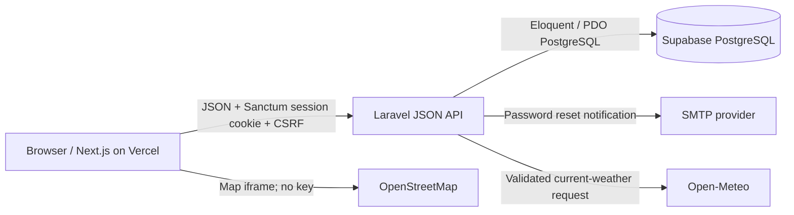

# Waypoint

Waypoint is a responsive, secure personal dashboard built for the System Integration midterm remediation project. It combines a Next.js frontend with a Laravel JSON API, PostgreSQL persistence, session-based authentication, TOTP multi-factor authentication, password recovery, a live OpenStreetMap view, and current weather from Open-Meteo.

This repository contains source code and configuration examples, not production credentials or deployed URLs. You must configure your own providers, push the project to your GitHub account, and verify the deployment before claiming it is live.

See [PROJECT-DESCRIPTION.md](./PROJECT-DESCRIPTION.md) for the complete project description, requirement coverage, security mapping, deployment overview, live demo walkthrough, and submission checklist.

## Features

- Registration and sign-in with server-side validation and bcrypt password hashing.
- Laravel Sanctum cookie sessions with CSRF protection and protected API routes.
- Rate-limited login, password recovery, MFA verification, and MFA management.
- Time-based one-time password (TOTP) enrollment, verification, encrypted secret storage, and replay protection.
- Time-limited, one-use Laravel password reset tokens; generic recovery responses avoid revealing registered accounts.
- Responsive protected dashboard with weather, map, geolocation, user profile, and logout.
- Supabase/PostgreSQL-compatible Laravel database configuration and migrations.
- OpenStreetMap map embedding and Open-Meteo current weather API proxy; neither provider needs a browser API key.

## Architecture



The browser calls Laravel using the configured `NEXT_PUBLIC_API_URL`. Sanctum authenticates the browser with an HttpOnly session cookie; the frontend sends the separate XSRF cookie value in `X-XSRF-TOKEN` for state-changing requests. Laravel validates requests, authorizes protected routes, and reads/writes user/session data in PostgreSQL. Weather is fetched server-side and only the needed current conditions are returned to the browser. OpenStreetMap is shown in an embedded map, and browser geolocation is optional and permission-based.

## Technology

- Frontend: Next.js App Router, React, TypeScript, CSS.
- Backend: PHP 8.2+, Laravel 12, Laravel Sanctum, `pragmarx/google2fa-laravel`.
- Database: PostgreSQL (Supabase recommended).
- External APIs: OpenStreetMap and Open-Meteo.
- Hosting target: Vercel frontend; Docker-compatible PHP host for Laravel; Supabase for PostgreSQL.

## Local setup

### Requirements

- Node.js 20.9+ and npm.
- PHP 8.2+ with `pdo_pgsql`, `mbstring`, `bcmath`, `intl`, and `zip`; add `pdo_sqlite` to run the backend tests.
- Composer 2.
- A PostgreSQL database, local or Supabase.

### 1. Configure PostgreSQL and Laravel

Create a database or Supabase project. For Supabase, use its PostgreSQL connection settings; a transaction pooler can be useful for serverless-like workloads, but use the provider's current connection instructions and SSL requirement.

In PowerShell:

```powershell
Copy-Item backend\.env.example backend\.env
Set-Location backend
composer install
php artisan key:generate
```

Set the database values in `backend\.env` (`DB_HOST`, `DB_PORT`, `DB_DATABASE`, `DB_USERNAME`, `DB_PASSWORD`, `DB_SSLMODE`). The example uses `pgsql` and `sslmode=require`. Then create the schema:

```powershell
php artisan migrate
```

Because Composer was not available when this starter was created, no `composer.lock` is included yet. The first `composer install` resolves dependencies and creates one; review and commit that lock file before publishing or deploying for reproducible builds.

For local development, `MAIL_MAILER=log` writes reset notifications to the Laravel log (`backend\storage\logs\laravel.log`). To actually receive recovery email, configure an SMTP mailer and sender address in the backend environment.

Run the API:

```powershell
php artisan serve --host=127.0.0.1 --port=8000
```

### 2. Configure and run the frontend

Open another PowerShell window from the repository root:

```powershell
Copy-Item frontend\.env.example frontend\.env.local
Set-Location frontend
npm install
npm run dev
```

Visit `http://localhost:3000`. The frontend environment variable `NEXT_PUBLIC_API_URL` should point to the Laravel origin, normally `http://localhost:8000`.

The backend example allows `http://localhost:3000` and declares the local frontend as a Sanctum stateful domain. Leave `SESSION_DOMAIN` blank locally so the browser uses a host-only cookie. If you change either local port or hostname, keep `CORS_ALLOWED_ORIGINS` and `SANCTUM_STATEFUL_DOMAINS` aligned.

## Environment variables

Never commit `.env`, `.env.local`, actual passwords, private API credentials, or generated Laravel keys.

### Frontend

| Variable | Example | Purpose |
|---|---|---|
| `NEXT_PUBLIC_API_URL` | `http://localhost:8000` | Public Laravel API origin. It is intentionally browser-visible and is not a secret. |

### Backend

| Variable | Purpose |
|---|---|
| `APP_KEY` | Laravel application encryption key; generate with `php artisan key:generate`. Never expose it. |
| `APP_URL` | Public Laravel API URL. |
| `FRONTEND_URL` | Frontend origin used to build password-reset links. |
| `DB_CONNECTION` | Keep `pgsql` for PostgreSQL/Supabase. |
| `DB_HOST`, `DB_PORT`, `DB_DATABASE`, `DB_USERNAME`, `DB_PASSWORD`, `DB_SSLMODE` | Private PostgreSQL connection settings; never expose them to the frontend. |
| `CORS_ALLOWED_ORIGINS` | Comma-separated exact browser origins allowed to send credentialed API requests. |
| `SANCTUM_STATEFUL_DOMAINS` | Comma-separated frontend hostnames, including the port for local development. |
| `SESSION_DOMAIN` | Cookie domain. Leave blank locally; for a production subdomain setup, use the shared parent domain. |
| `SESSION_SECURE_COOKIE` | Set `true` for HTTPS production. |
| `SESSION_SAME_SITE` | Use `lax` for local development. Production should use `none` only when necessary, together with Secure cookies. |
| `MAIL_MAILER`, `MAIL_HOST`, `MAIL_PORT`, `MAIL_USERNAME`, `MAIL_PASSWORD`, `MAIL_FROM_ADDRESS` | Private email-provider settings for delivering reset links. |
| `BCRYPT_ROUNDS` | Work factor for Laravel's bcrypt password hashing. |

`backend/.env.example` and `frontend/.env.example` contain placeholders only. Variables beginning with `NEXT_PUBLIC_` are compiled into browser JavaScript: do not put credentials there.

## Database and data flow

`backend/database/migrations` creates users, password reset tokens, database-backed sessions, and cache tables. The `users` table stores a bcrypt-hashed password and MFA state. MFA secrets are encrypted by Laravel's encrypted model casts before database storage. Database credentials are read only by Laravel from its server-side environment.

Apply migrations with `php artisan migrate`. For production, back up the database first and apply reviewed migrations as part of deployment. The Docker entrypoint currently applies migrations on container startup (`php artisan migrate --force`); disable that behavior and run migrations as a controlled release step if your hosting workflow requires stricter production change management.

## API endpoints

All routes below are prefixed with `/api` except Sanctum's CSRF endpoint. JSON request/response examples omit routine headers. Authenticated routes require the Sanctum browser session and CSRF header for state changes.

| Method | Path | Auth | Purpose |
|---|---|---|---|
| `GET` | `/sanctum/csrf-cookie` | No | Issue the CSRF cookie before login or another state-changing request. |
| `POST` | `/api/register` | No | Create account and sign in. Requires `name`, `email`, `password`, `password_confirmation`. |
| `POST` | `/api/login` | No | Sign in, or indicate that TOTP verification is required. |
| `POST` | `/api/mfa/login` | Pending MFA session | Verify the six-digit code and finish sign-in. |
| `POST` | `/api/forgot-password` | No | Request a reset email; the response is generic. |
| `POST` | `/api/reset-password` | No | Consume `token`, `email`, `password`, `password_confirmation`. |
| `GET` | `/api/user` | Yes | Return the signed-in user's public profile and MFA status. |
| `POST` | `/api/logout` | Yes | Invalidate the session and rotate the CSRF token. |
| `GET` | `/api/weather?latitude=14.5995&longitude=120.9842` | Yes | Return validated current conditions from Open-Meteo. |
| `POST` | `/api/mfa/setup` | Yes | Generate a pending TOTP enrollment URI. |
| `POST` | `/api/mfa/confirm` | Yes | Verify setup code and enable MFA. |
| `POST` | `/api/mfa/disable` | Yes | Verify current code and disable MFA. |

Example registration request:

```json
{
  "name": "Alex Morgan",
  "email": "alex@example.test",
  "password": "ExamplePass123",
  "password_confirmation": "ExamplePass123"
}
```

Successful registration returns `201` and `{"user":{"id":1,"name":"Alex Morgan","email":"alex@example.test","mfa_enabled":false}}`. An MFA-enabled login returns `{"requires_mfa":true}`; the next request supplies `{"code":"123456"}` to `/api/mfa/login`.

Validation errors use JSON with a `message` and field-specific `errors`. Weather provider errors return `503`; authentication and malformed input errors are not reported as successful responses.

## Authentication, recovery, and MFA

1. The frontend requests `/sanctum/csrf-cookie`, then submits registration or login with cookies enabled.
2. Laravel validates credentials, hashes new passwords using bcrypt, rotates the session ID after authentication, and serves protected API routes through `auth:sanctum`.
3. If MFA is active, Laravel records a short-lived pending user ID in the session without authenticating the user; only a valid, rate-limited TOTP code completes sign-in.
4. To enroll MFA, the signed-in user adds the returned secret (or `otpauth://` URI) to an authenticator app and proves possession with a current code. Pending enrollment expires after ten minutes; pending and active secrets are encrypted in the database. A successfully used time-step cannot be replayed.
5. Password recovery uses Laravel's time-limited token broker. The API returns the same accepted response whether or not the email is registered; successful use invalidates the token and rotates the remember token. Configure SMTP to deliver messages outside local development.

## Security controls

- Password hashing, password validation, and SQL parameterization are enforced in Laravel, not trusted to client-side checks.
- Authentication uses Sanctum session cookies (HttpOnly, encrypted session storage, CSRF checks), not tokens persisted in browser local storage.
- CORS allows explicit origins and credentials; never replace the allowlist with wildcard origins.
- Login, recovery, MFA verification, and MFA management are rate-limited. Password reset errors do not expose account existence.
- MFA TOTP secrets are encrypted with `APP_KEY`; protect and back up that key.
- Weather inputs are range-validated and provider failures are logged server-side with safe client-facing messages.
- Production must use HTTPS, a restricted database user, SMTP credentials in host secrets, `APP_DEBUG=false`, and secure cookie settings.
- For cross-origin deployment, browsers may block third-party cookies. Prefer a custom frontend and API under the same site (for example `app.example.com` and `api.example.com`), configure the shared cookie domain, and use Secure cookies. A default `vercel.app` frontend paired with an unrelated API hostname may not support the required session-cookie flow reliably.

### Where controls are enforced

| Control | Enforcement point |
|---|---|
| Registration/login validation and password hashing | `backend/app/Http/Controllers/AuthController.php`; hashed password model cast in `backend/app/Models/User.php`. |
| Protected API and user authorization | `auth:sanctum` route group in `backend/routes/api.php`; stateful cookie middleware in `backend/bootstrap/app.php`. |
| CSRF and session rotation/invalidation | Laravel Sanctum and session middleware; `AuthController` login/register/logout actions; frontend CSRF header in `frontend/src/app/page.tsx`. |
| Login, reset, and MFA request throttles | Named limits in `backend/app/Providers/AppServiceProvider.php`, applied in `backend/routes/api.php`. |
| Generic reset response, token expiry, one-use reset | `backend/app/Http/Controllers/PasswordResetController.php`; expiry and throttle settings in `backend/config/auth.php`. |
| MFA secret encryption, expiring pending enrollment, TOTP replay checks | Encrypted casts and expiry cast in `backend/app/Models/User.php`; enrollment/verification in `backend/app/Http/Controllers/MfaController.php` and `AuthController.php`. MFA verification updates are serialized with database row locks. |
| CORS origins and credentialed requests | `backend/config/cors.php`, `CORS_ALLOWED_ORIGINS`, and `SANCTUM_STATEFUL_DOMAINS`. |
| SQL injection prevention | Eloquent parameterized queries and Laravel's validated query builder usage in backend controllers. |
| Weather request validation and safe upstream errors | `backend/app/Http/Controllers/WeatherController.php`. |
| Private configuration | `backend/.env.example`, `frontend/.env.example`, and `.gitignore`; only the API origin is browser-visible. |

## Demonstration and code walkthrough

Before the live demo, deploy and test the application yourself. A suggested walkthrough:

1. Show the GitHub repository structure and explain the `frontend` and `backend` folders.
2. Open the deployed HTTPS frontend and register a new account.
3. Show the profile, weather response, and map; optionally allow location access to refresh the map and weather.
4. Enroll an authenticator app under Two-factor auth, sign out, and demonstrate a sign-in that requires the current TOTP code.
5. Request password recovery using the configured SMTP mailbox, open the time-limited email link, and set a new password.
6. Sign out and show the protected API rejects unauthenticated requests; sign in again and demonstrate logout.
7. Explain browser JSON/CSRF requests in `frontend/src/app/page.tsx`, API routing in `backend/routes/api.php`, validation/authentication in `backend/app/Http/Controllers`, persistence and MFA encryption in `backend/app/Models/User.php`, schema in `backend/database/migrations`, and deployment values in the host dashboards.
8. Explain one integration troubleshooting case: check `NEXT_PUBLIC_API_URL`, the browser Network panel, Laravel logs, CORS origin allowlist, Sanctum stateful domain, and cookie domain/SameSite/Secure settings.

This is a code and demo guide, not evidence that a production deployment or live email delivery has already been tested.

## Deployment

### Vercel frontend

1. Push this repository to your own GitHub account.
2. Import it in Vercel and set the project root directory to `frontend`.
3. Use the Next.js framework preset and leave the build command at `npm run build`.
4. Configure `NEXT_PUBLIC_API_URL` to the deployed Laravel API origin.
5. Add the production frontend origin to Laravel's `CORS_ALLOWED_ORIGINS` and `SANCTUM_STATEFUL_DOMAINS`.
6. Set up the shared custom domain/cookie configuration described above, redeploy, then test auth and dashboard requests in a browser.

The frontend includes `frontend/vercel.json` to identify the Next.js framework. This config does not create a Vercel project or deploy it; deployment still requires your Vercel account and provider settings.

### Laravel API on a Docker-compatible PHP host

`backend/Dockerfile` builds the Laravel API on PHP 8.3 with PostgreSQL support. Create a web service from the repository using `backend` as the Docker context and `backend/Dockerfile` as the Dockerfile path. Set the API's private environment values in the host dashboard:

- `APP_ENV=production`, `APP_DEBUG=false`, generated `APP_KEY`.
- `APP_URL`, `FRONTEND_URL`, and matching CORS/Sanctum/cookie settings.
- Supabase PostgreSQL connection settings and `DB_SSLMODE=require`.
- Production SMTP settings and an approved sender address.
- `SESSION_SECURE_COOKIE=true`; use the cookie domain and `SESSION_SAME_SITE` matching the custom domains.

The container listens on the host-provided `PORT` (or 10000 locally). Check the deployed `/up` health endpoint and logs. The current entrypoint runs migrations at startup; use a controlled migration release step if required by the host or production policy.

### Supabase

Use the PostgreSQL connection values from your Supabase project's database settings. Keep the database password and connection details in the Laravel host's secret environment settings. This application connects from Laravel using PostgreSQL/PDO; browser code never uses a Supabase service-role or database credential.

### URLs to record after deployment

- GitHub repository: `https://github.com/<your-account>/<your-repository>`
- Vercel frontend: `https://<your-frontend-domain>`
- Laravel API: `https://<your-api-domain>`

These are placeholders, not claims of completed deployment. Verify registration, login, protected-route denial, map, live weather, password recovery email, MFA enrollment/sign-in, and logout on the deployed frontend before presenting the application.

## Validation

From `frontend`, run:

```powershell
npm run lint
npm run build
```

From `backend`, after installing PHP and Composer dependencies:

```powershell
composer install
php artisan test
php artisan route:list --path=api
```

## Known limitations

- The map uses OpenStreetMap's public embed and has no provider key or custom geocoding search.
- Weather uses the Open-Meteo public forecast API and requires network access; provider outages are surfaced.
- Local recovery messages use Laravel's log mailer until SMTP is configured.
- A deployed session-cookie login needs compatible custom domains and HTTPS; code cannot configure or verify your provider account or deployed site.
- Backend tests cannot run in an environment without PHP and Composer.
- The current full frontend dependency audit reports high advisories in the development-only Next.js ESLint dependency chain; the production dependency audit reports no vulnerabilities. Recheck and update the lint toolchain as upstream fixes become available.
